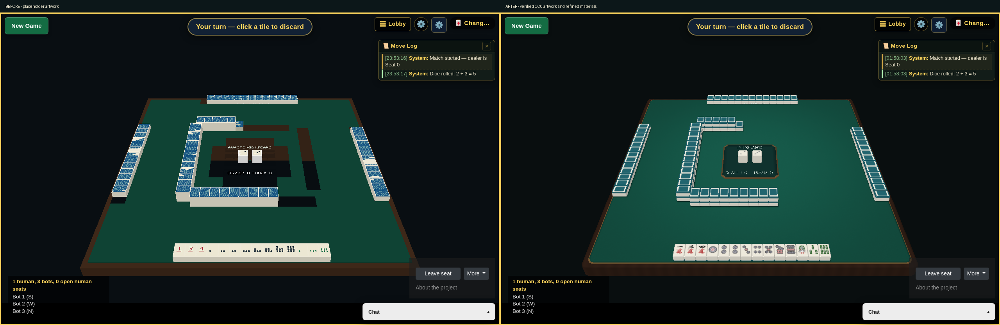

# mahjong-unity

**Working Unity browser game—scoped local gameplay and Docker qualification
approved.** The pinned host Editor accepted existing portable Hub activation,
passed **120/120 EditMode tests**, and produced genuine non-development WebGL.
Tester approved native actions across all five existing modes and a healthy
Docker-hosted player, retaining the previously approved Changsha and mobile
layout evidence. This is no longer an unbuilt/source-only renderer.

The earlier approved runtime iteration used a disclosed dirty-source artifact.
Final source revisions are committed, all four source CI jobs are green, and
the **clean 120-test WebGL rebuild, strict validation, canonical image packaging,
native runtime checks and live preview upgrade passed**. The first working
local iteration is delivered. Physical iOS/Android and touchscreen double-tap discard
are limits of this first working iteration, not current completion blockers;
redistribution clearance is separate. Missing or invalid artifacts still produce a visible
**table unavailable** state, not a fake or legacy renderer fallback.

## What is preserved

- Behavioral baseline:
  `long2know/mahjong-autotable@d10d351e543aa3e341960de9800828b6c0662a82`.
- All five modes: **Changsha, four-player, three-player, Bamboo, and Minefield**.
  Changsha retains server authority; the others retain their existing
  collaborative relay semantics.
- Existing .NET rules/runtime, APIs, raw WebSocket **`/autotable/ws`**, and
  SignalR **`/hubs/changsha`**. Unity does not replace the transport or evaluate
  game rules.
- Browser lobby, identity/reconnect flow, room/rule controls, and chat. Existing
  room-chat gating to bound Changsha rooms is retained—not newly promised for
  every relay mode.

The imported source and regression fixtures are authoritative. Linked rule
guides and inspect-only Unity/Japanese-rule examples do not authorize changes
to that baseline.

## Refined tiles and table

The placeholder faces are replaced with all **37 traditional tile faces** from
the pinned CC0 FluffyStuff artwork, including winds, dragons and red fives.
Original ivory/two-tone beveled bodies, quiet jade/amber backs, softly textured
felt, rounded walnut/brass rails and clearer public labels complete the table.
The fabric reuses the existing CC0 texture; the faces use the creator's verified
standalone CC0 release rather than the legacy noncommercial artwork.



The polish preserves privacy, native picking and the rectangular/separate-hand
mobile layouts. Shared material paths, vertex lighting, bounded geometry and
mip-filtered artwork avoid the first draft's expensive rendering path.
The software-browser comparison still has a documented visual cost: about
29.4 versus 37.7 presentation Hz on desktop and 23.5 versus 27.9 in portrait,
with native selection latency about 11% higher. These are isolated container
observations, not physical-device FPS guarantees.

The local preview on port 5086 serves a qualified clean-source image without a
dirty-build override. Its exact current source/image identity is recorded in
`artifacts/preview/desktop-changsha-20261010/protected-start-config.json`.
Historical tile-polish Editor, runtime and post-upgrade native-input receipts remain under
`artifacts/test-results/visual-polish-clean-build/` and
`artifacts/test-results/visual-polish-clean-runtime/`. Existing protected
configuration and persistent database state were preserved.

## Table camera controls

Pinch with two fingers over the table to resize/zoom it. Drag both fingers to
turn or tilt the table; twist them to roll the view. With a mouse, use the wheel
to zoom and **Alt+left-drag** or **middle-drag** to orbit; add **Shift** to roll.
Ordinary single-touch tile actions and unmodified mouse picking stay unchanged.

Focus the canvas for keyboard controls: **Left/Right** turn, **Up/Down** tilt,
**Shift+Left/Right** roll, **+/-** zoom, and **Home** resets the view. Both existing
settings drawers also expose camera sliders and **Reset view**. Camera preferences
are saved locally. Manual zoom can intentionally crop/enlarge the table; reset
restores automatic fitting. The separate hand stays upright and fixed.

## Source delivered

| Surface | Location and boundary |
| --- | --- |
| Existing server and rule tests | `src/backend/`; preserved .NET implementation |
| Browser shell/adapter | `src/frontend/autotable-src/`; retained Client/World/Setup/Movement with a data-only renderer seam |
| Unity renderer source | `unity/MahjongRenderer`; contract pin **6000.3.24f1**, verified CC0 artwork and original meshes, flat/perspective and rectangular/separate-hand presentation |
| Frozen renderer protocol | `contracts/renderer-v1.schema.json`, **1.0.0**; complete frame/layout snapshots, opaque entity actions, rendered-frame readiness |
| Build/hosting tooling | `build.sh` / `build.ps1`, Docker Unity builder, real-Editor producer, artifact validator, separate ASP.NET hosting image |
| Provenance/notices | `contracts/source-provenance.json`, inherited frontend `COPYING`, `THIRD_PARTY_NOTICES.txt` |

EditMode/source checks alone are not gameplay evidence; the actual browser and
Docker results below supply the approved local scope, not physical-device or
performance guarantees.
Renderer v1 also has explicit UI limits: sticky click-to-grab is disabled
(press/drag/release only), and the legacy GPU benchmark is retired. This is not
a claim of complete legacy renderer-input or benchmark parity.

## Build/run and local preview

The upgraded clean user preview is running at
**`http://127.0.0.1:5086/autotable/`**, with no `unityLocalBuild` parameter.
Seeded Changsha:
`http://127.0.0.1:5086/autotable/?gameId=preview&createGame=preview&variant=changsha&seat=0&botCount=3&dealMode=auto&seed=20261010`.
An existing named room can retain occupied seats; the link does not guarantee
seat 0 to a fresh browser. Use the normal join/seat UI or a different table.
Protected private operator state outside `/data` was preserved; do not replace
its configuration or persistent data with a new installation. The healthy
preview remains running with restart policy `unless-stopped`.

The final real-Editor rebuild has produced **genuine clean WebGL artifacts**.
The strict Docker packaging command consumes those existing outputs:

```bash
BUILDX_BUILDER=default ALLOW_SOURCE_DIRTY=0 bash build.sh \
  --skip-unity-build --tag mahjong-unity:local
```

PowerShell counterpart: `./build.ps1 -SkipUnityBuild -Tag mahjong-unity:local`,
with `ALLOW_SOURCE_DIRTY` unset or `0`. This runs artifact validation and
Node/.NET/runtime packaging in Docker; it does not create missing Unity output
or replace actual native/runtime verification. See the
[protected configuration and startup commands](docs/integration/docker-build-and-run.md#start-the-hosting-image).
New Compose installations default to `http://127.0.0.1:8950/autotable/`;
existing operators must retain their project/volume identity.

The optional host build uses the already-installed **6000.3.24f1** Editor and
accepted portable Hub activation, not an installed 6.6 Editor. From
`/data/source/mahjong-unity`, apply the Hub's HOME/XDG paths **to this process
only**:

```bash
env HOME="/data/programs/Unity/UnityHubSetup-x86_64.AppImage.home" \
  XDG_CONFIG_HOME="/data/programs/Unity/UnityHubSetup-x86_64.AppImage.home/.config" \
  XDG_DATA_HOME="/data/programs/Unity/UnityHubSetup-x86_64.AppImage.home/.local/share" \
  XDG_CACHE_HOME="/data/programs/Unity/UnityHubSetup-x86_64.AppImage.home/.cache" \
  UNITY_EDITOR="$PWD/artifacts/test-results/unity-u2-archive-route/6000.3.24f1/Editor/Unity" \
  bash scripts/build-unity-webgl.sh --test-and-build
```

Do not persistently change normal HOME, reactivate the accepted Editor, or
export/copy license contents. The version-named directory and old `vendor`
compatibility link remain; no Hub GUI-registration change is claimed.
Development builds remain rejected. `--allow-source-dirty` is only for disclosed
local qualification, never a replacement for a real clean-source rebuild.

The default repo-managed Docker Unity builder remains available, but packages
tools rather than activation. Its private licensing compatibility must be
checked separately; the successful host Hub route does not prove container
activation or a paid/free headless licensing route.

- [Docker build/run, verified host Editor, cache/output paths, troubleshooting](docs/integration/docker-build-and-run.md)
- [Renderer contract, lifecycle, privacy and presentation boundaries](docs/integration/renderer-v1.md)
- [Licensing, excluded assets and source provenance](docs/integration/licensing-and-provenance.md)

## Validation and remaining gates

**Tester APPROVE recorded October 11, 2026, 01:01:59 UTC
(October 10, 18:01:59 PDT): scoped local player/runtime qualification passed.**

| Area | Verified result—not production qualification |
| --- | --- |
| Backend/hosting | **90 focused .NET + 33 tooling tests**, plus Tester's **57 room/relay/reconnect/continuation tests**, no failures/skips. Actual API Release publish and localhost Development/test-database smoke: health, SignalR negotiation, raw WS open/close, missing-Unity 404s without HTML fallback, and clean shutdown. Not a Docker runtime/gameplay test. |
| Browser adapter | **38 preserved + 40 renderer-specific Node tests**, rerun after independent revision, plus **2 actual Game startup/auto-resize regressions**. Strict primary-graph TypeScript check and an actual asset-free Vite build passed. Real Client/World/wire/gesture and Vite/source tests with explicitly simulated browser/runtime services—not a Unity player. |
| Real browser shell | **6 Chromium-container cases** passed: desktop/phone-sized lobby and missing-build routes, invitations/join, chat receive/reload, and responsive viewport routing. Real localhost API and served bundle; no Unity player, rendered board input, actual iOS/Android device, touch or mobile-performance qualification. |
| Unity Editor/WebGL | Actual **6000.3.24f1 / 4e7b9b5b6244** host Editor accepted Hub licensing, compiled/imported the project and IL2CPP WebGL, passed **120/120 EditMode tests**, and passed the successful WebGL BuildReport gate. The polished committed-source rebuild has **`sourceDirty: false`, `developmentBuild: false`**; strict artifact validation passed without the dirty override. |
| Native relay gameplay | All four relay modes: **8 tile/stick drag gestures**, each with one committed target write and actual server echo; **16 F / Shift+F / right-click / R routes** verified. Real C# callbacks and rendered pixels, not simulated readiness. |
| Changsha and mobile layouts | Previously approved actual manual/automatic C# pickup/discard, count-only pickup wire, chat, privacy, spectator and reconnect scopes retained. **294/294 hand centers across 21 browser layouts**, portrait/landscape, DPR **1/2/3**, chat collapsed/open; formerly blocked lower-row native selection/discard passed. These preserved scopes were not all rerun in the final relay review. |
| Docker-hosted player | Actual runtime health and Docker healthcheck passed, with genuine hosted Unity files/MIME, matching frontend assets and native/server-echo evidence. Both the initial **`mahjong-unity:final-684f678`** and updated **`mahjong-unity:polished-95d06eb`** runtimes passed without dirty opt-in. Non-root, read-only rootfs, dropped capabilities and no-new-privileges are retained. |
| Docker context | Tester approved the independent `.dockerignore` revision after **9 source/context gates**. Actual scratch-export filename probes verify filtering, not a production Unity build. |

Authoritative scoped approval:
`artifacts/test-results/migration-player-final-relay-review.json`.
Its `actualArtifact`, `actualEditorEvidence`, `actualRuntimeEvidence` and
preserved-qualification sections record exact identities and scope. Actual
Earlier 99-test native-review build evidence is
`artifacts/test-results/relay-native-target-repair/editor-rebuild-receipt.json`.
The final clean build is recorded in
`artifacts/unity-webgl/renderer-build.json`, built **October 11, 2026,
01:07:03 UTC**, with actual passing results at
`artifacts/test-results/unity-editmode.xml`. Read each produced manifest for its
identity/cleanliness rather than treating an earlier hash as current.
These are local ignored outputs, not files supplied by a fresh source checkout.

Final clean runtime and preview-upgrade evidence:
`artifacts/test-results/final-clean-runtime/summary.json` and
`artifacts/test-results/final-clean-runtime/preview-upgrade-receipt.json`.
The operational handoff was recorded **October 11, 2026, 02:12:40 UTC**.
Clean isolated Changsha native discard and THREE_PLAYER tile/stick/keyboard
checks passed; after upgrade, actual C# rendering, `frameRendered` and native
discard passed on the live preview without dirty opt-in. Existing private
key/configuration and persistent database identities were preserved.

Source evidence: `artifacts/test-results/backend-summary.json`,
`artifacts/test-results/backend-final-compatibility/backend-final-compatibility.trx`,
`src/frontend/autotable-src/.unity-validation/f1-source-evidence.json`, and
[`unity/MahjongRenderer/Documentation/source-evidence.json`](unity/MahjongRenderer/Documentation/source-evidence.json).
Runtime/test logs under `artifacts/` and `.unity-validation/` are local ignored
outputs. The **373-module** browser source graph and `renderer-module-graph.json`
are not Unity WebGL artifacts. These are targeted checks, not full-suite,
performance, or device evidence.

The original F1 receipt is the author's source snapshot, not integration
approval. Tester's actual-caller review found two startup/resize bugs; their
independent revisions passed the regression and affected suites. Current
revision evidence is `artifacts/test-results/lead-browser-caller-evidence.json`
and `lead-browser-{integration-final,source-tests,typecheck,build}.log`.
The real-browser receipts are
`artifacts/test-results/migration-browser-actual/browser-unavailable-receipt.json`
and `browser-social-receipt.json`. The lock-matched Playwright **1.60.0**
Linux/amd64 container worked despite the local host Chrome `SIGTRAP` launch
failure. These receipts qualify shell/social behavior, not the Unity player.
See [repeatable browser-shell commands and prerequisites](docs/integration/docker-build-and-run.md#real-chromium-container-shell-checks).

For an already-provisioned development/CI Node environment (not an additional
host prerequisite for Docker packaging), the existing manifest exposes:

```bash
cd src/frontend/autotable-src
npm run typecheck
npm run build
npm run test:unity
```

`test:unity` is the passing **Node source** suite, not Unity Editor tests.
See the [exact source-check commands and receipts](docs/integration/docker-build-and-run.md#verified-source-checks).

The initial working-game source/CI/test revisions are committed at
`684f67837eb9fbef0475162702f5d3542d87b949`. Its actual **99-test clean rebuild
and strict validation passed**, and all four source CI jobs are green. Earlier
all-mode/mobile proof remains the approved scope; final canonical clean-image
packaging, native health/player checks and the live 5086 preview upgrade also
passed. See PR #10 for delivery history.
Physical iOS/Android, touchscreen double-tap discard, exhaustive gesture/target
coverage and performance remain qualification limits, not blockers to this
first working local iteration.

**Redistribution is also gated:** the owner has not selected a root/original
additions license, and a complete shipped dependency notice inventory is still
required. The inherited MIT code notice excludes images/sounds and does not
license all fork/backend code or dependencies. Noncommercial inherited tile
art, Majsoul sample resources and bundled sample assets are excluded. Authorized
local development/build/testing can proceed without claiming a production
release license.
